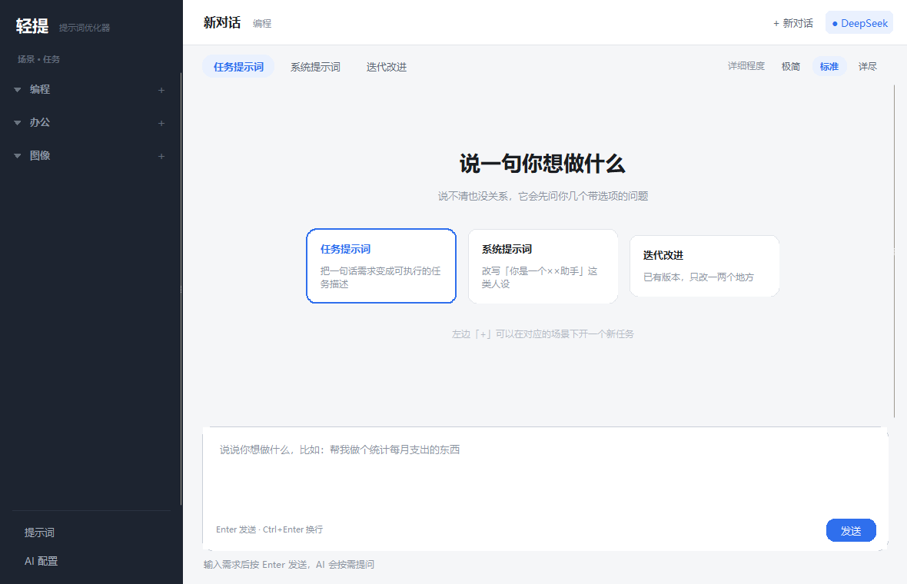
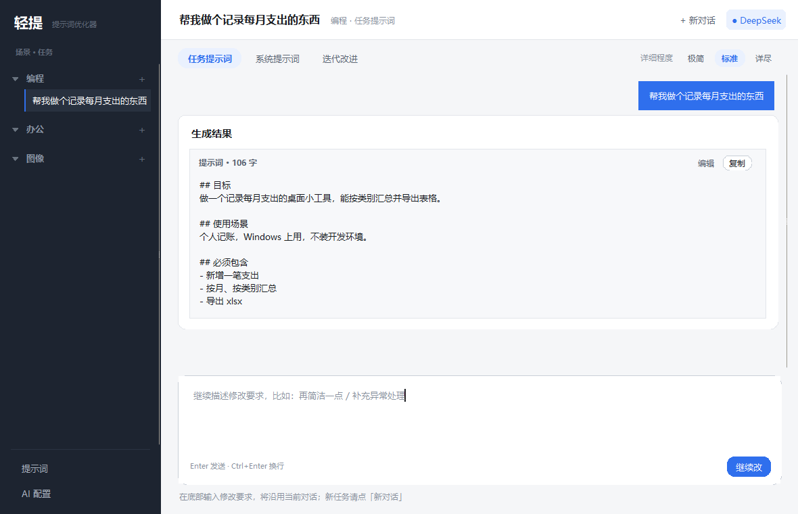

# 轻提 · QingTi

> 把你的大白话，变成 AI 真正听得懂的提示词。

轻提是一个**完全本地运行**的桌面提示词优化器。你说一句口语化的需求——"我想做个记账的东西""帮我给领导写个周报""想要一张橘猫蹲在窗台上的图"——它会先反问你两三个带选项的问题，你点几下鼠标，就能拿到一份结构完整、可直接投喂给模型的提示词。

纯 Python 标准库实现（Python 3.10 + tkinter），**零第三方依赖**，不联网上传任何内容，不写注册表。

- 仓库：<https://gitee.com/linhaonan126/qingti>
- 许可：[MIT](LICENSE)

---





## 它解决什么问题

大多数人写不出好提示词，不是因为不会写，而是因为**不知道该交代什么**：没说场景、没说受众、没说输出格式、没说不要什么。模型只能靠猜，猜出来的东西自然不对味。

轻提把这件事拆成两步：

1. **反问**：先判断这句话缺了哪些关键信息，用带 ★推荐 的选择题问你（最多 3 轮，每题 3–4 个选项，随时可以"就这些，开始吧"跳过）；
2. **改写**：把你的回答 + 原话合成一份专业提示词，补齐角色、约束、结构、验收标准，并附一句"我补了什么"，让你知道它猜了哪些。

---

## 功能

| 功能 | 说明 |
|---|---|
| 三个场景 | **编程** / **办公** / **图像**，共 13 套提示词模板 |
| 多轮反问 | 模型用固定标记返回选择题，界面渲染成可点的卡片，选项带推荐项 |
| 三级详细程度 | 极简 / 标准 / 详尽，控制补齐的信息量 |
| 流式输出 | 字一个个冒出来，可关闭 |
| 任务持久化 | 左侧任务树，新建 / 切换 / 重命名 / 删除 / 收起展开，关掉软件再开还在 |
| 模板可改 | 提示词就是 `prompts/*.md`，内置编辑器改完即生效，可一键恢复默认 |
| 多份 AI 配置 | 名称 / 地址 / 模型 / 密钥分开存，随时切换，支持"拉取"模型列表与"测试连接" |
| 密钥加密 | Windows DPAPI 加密，只有当前系统账号能解开 |
| 零依赖 | 只用标准库，装个 Python 就能跑，也可以打成单文件 exe |

### 场景与模板

| 场景 | 模式 | 适合 |
|---|---|---|
| 编程 | 任务提示词 | 把"做个记账工具"变成可执行的需求描述 |
| 编程 | 系统提示词 | 写代码审查、结对编程这类人设 |
| 编程 | 迭代改进 | 已有版本，只改一两处 |
| 办公 | 任务提示词 | 周报、方案、邮件、纪要、数据分析 |
| 办公 | 系统提示词 | 写作助手、分析师类人设 |
| 办公 | 迭代改进 | 已有材料，调整语气或结构 |
| 图像 | 文生图 · 通用 | Gemini / GPT 这类多模态模型 |
| 图像 | 文生图 · 中文美学 | 即梦、通义万相、可图 Kolors |
| 图像 | 文生图 · JSON | 要结构化、便于程序复用的场景 |
| 图像 | 图生图 · 通用 | 改风格、换背景、调光线 |
| 图像 | 图生图 · 换字 | 设计稿里的文字替换 |
| 图像 | 迭代 | 在上一版图上继续微调 |

---

## 安装

### 方式一：源码运行（推荐）

需要 **Python 3.10 或更高**，且带 tkinter（Windows 官方安装包自带）。

```bash
git clone https://gitee.com/linhaonan126/qingti.git
cd qingti
python app.py
```

Windows 下也可以直接双击 `启动.bat`。

### 方式二：打包成 exe

```bash
pip install pyinstaller
python -m PyInstaller --clean --noconfirm 轻提.spec
```

产物在 `dist/轻提.exe`，单文件、免安装，拷到任意机器双击即用（目标机器不需要 Python）。

> 未签名的自编译程序首次运行会被 Windows SmartScreen 拦一下：点「更多信息」→「仍要运行」。

---

## 配置

打开软件**不弹配置框**，先点左下角 **「AI 配置」** → **「+ 新增 AI 配置」**。

新建时默认已经填好 **DeepSeek** 的名称与接口地址（`https://api.deepseek.com/v1`），模型名留空——点「拉取」会列出这家所有可用模型，选一个即可。

| 字段 | 说明 |
|---|---|
| 名称 | 自己认得出的名字，如「DeepSeek 主号」 |
| 服务商 | 下拉选择，地址与常用模型自动带出：OpenAI、Anthropic、Gemini、DeepSeek、通义千问、Kimi、智谱、MiniMax、硅基流动、火山方舟、百度千帆等 |
| 接口地址 | 填到 `/v1` 这一级；程序会自动修正重复的 `/v1/v1`、多余的 `/chat/completions` |
| API Key | 粘进去，点「测试连接」验证；DPAPI 加密存本地，再次进入会打码回填 |
| 模型名 | 可手填，可点「拉取」从接口取列表 |
| 流式输出 | 默认开，字一个个出现 |
| 超时 | 秒，默认 120 |

可以存多份配置，列表里点「设为当前」切换。

> 换电脑或换 Windows 账号后密钥解不开属正常现象——DPAPI 与系统账户绑定，重填即可。

---

## 使用

### 基本流程

1. 左侧选场景（编程 / 办公 / 图像），顶部选模式和详细程度；
2. 底部输入框用一句话说清你要什么，回车发送（`Ctrl+Enter` 换行）；
3. 如果信息不够，出现选择题卡片：点选项，或点「就这些，开始吧」跳过；
4. 拿到提示词，点「复制」直接用。

### 模板编辑

点左下角 **「提示词」**，左侧选模板，右侧直接改，保存后立即生效——改的就是 `prompts/` 里的 `.md` 文件，用记事本改也一样。

模板里只有两种语法：

```markdown
{{变量名}}             已知变量会被替换，未知的保持原样
{{#开关}}……{{/开关}}    开关打开时才保留这一段
```

文件头 `---` 之间的元信息（`id` / `name` / `scene` / `mode` / `version`）由程序读取，编辑器里不显示、不会改坏。改坏了点「恢复默认」，出厂副本存在 `%LOCALAPPDATA%\轻提\_defaults\`。

### 数据位置

| 内容 | 位置 |
|---|---|
| 提示词模板 | 项目目录 / exe 同级的 `prompts\*.md` |
| 配置与密钥、出厂副本 | `%LOCALAPPDATA%\轻提\` |
| **任务与对话记录** | **`文档\轻提\tasks.json`**（最多保留 300 个任务） |
| 错误日志 | `%LOCALAPPDATA%\轻提\error.log` |

聊天记录刻意**不放在安装目录，也不放在配置目录**：覆盖安装、升级新版本、甚至清掉
`%LOCALAPPDATA%\轻提`，历史都还在文档里。想备份就拷这个 `tasks.json`。
老版本留在配置目录里的记录，第一次启动会自动搬到新位置，原文件改名为
`tasks.json.migrated` 留个底。

---

## 常见问题

**测试连接失败，提示被 Cloudflare 挡住**
与密钥无关，是中转站的风控。程序已带浏览器身份请求；仍被挡说明该站点限制 API 直连，换一家。

**报 401 / 认证失败**
密钥不对或已过期。注意有些服务商用「项目 Key」而控制台给的是「管理 Key」。

**报 400，换个模型就好了**
部分模型不接受 `max_tokens` 或 `stream_options`。程序会自动摘掉这些字段重试一次；仍失败就在配置里关闭「流式输出」。

**模型没按格式回答**
界面会显示「模型没有按格式回答」并附原文。通常是模型能力不足，跟不住 `<<<PROMPT>>>` 这类标记。换更强的模型，或在模板里把格式要求写得更硬。

**输出像是被截断**
结果卡上方会标注「可能被截断」。把详细程度调成「极简」，或换上下文更长的模型。

**升级 / 重装后历史记录还在吗**
在。聊天记录存在 `文档\轻提\tasks.json`，跟安装包、跟配置目录都分开；只有在卸载时
勾选「同时删除配置和聊天记录」，才会删掉。

**滚轮要点了才能滚吗**
不用。鼠标进入对话区（哪怕只是停在某张卡片上）就能滚，不需要先点一下。

**提示词为什么这么长**
图像类模板另有约束：太短会缺信息，太长模型抓不住重点，一般在 150–450 字之间。

---

## 开发

### 目录

```
app.py          入口：启动、崩溃兜底、首次释放模板
core/           业务层（不 import tkinter）
  engine.py       对话编排：组装提示词 → 请求 → 解析 → 落历史
  llm.py          OpenAI / Anthropic / Gemini 三种协议 + 流式读取
  parse.py        文本标记协议解析
  templates.py    模板加载与变量渲染
  store.py        配置读写与 DPAPI 加解密
  sessions.py     任务持久化
  paths.py        路径解析（exe / 源码两种模式）
ui/             界面层（theme / widgets / sidebar / main_window / settings / editor）
prompts/        提示词模板，纯 Markdown
test/           测试与本地假 AI
tools/          打包、图标生成、截图、真实模型验收脚本
```

界面层不碰业务逻辑，业务层不依赖 tkinter——改界面对 `core/` 无影响。

### 文本标记协议

模型回复里只有两种块：

```
<<<ASK>>>                      提问
[{"q": "...", "type": "single",
  "opts": [{"label": "...", "desc": "...", "rec": true}]}]
<<<ASK_END>>>

<<<PROMPT>>>                   结果
（提示词正文）
<<<PROMPT_END>>>
```

解析器取第一个非空块；如果模型既没按格式回、也没给出可用内容，引擎会自动催一次（NUDGE）让它按格式重发。

### 测试

```bash
python test/test_parse.py        # 解析器：中文引号、围栏、空块、尾逗号
python test/test_engine.py       # 编排：跑偏补救、末轮强制出结果
python test/test_chat_flow.py    # 界面回归：欢迎页、结果卡、无内嵌输入框

python test/smoke_ui.py 6 --shot # 启动 6 秒后自动关，存截图
python test/smoke_flow.py        # 完整链路：发送 → 提问卡 → 跳过 → 结果卡
python test/smoke_sidebar.py     # 任务树：落盘 / 恢复 / 折叠 / 重命名 / 删除
python test/smoke_settings.py    # 配置页
python test/smoke_editor.py      # 模板编辑器
python test/smoke_fixes.py       # 若干交互回归
```

所有测试启动前都会通过 `test/_sandbox.py` 把 `LOCALAPPDATA` 指向临时目录，不会碰你本机的真实配置与聊天记录。

想用真模型验收提示词质量：

```bash
python test/mock_ai.py 8899          # 起一个本地假 AI，不需要 Key
python tools/live_prompt_test.py     # 用已配置的模型跑全部场景，报告写到 test/live_report.md
python tools/live_prompt_test.py image
```

### 打包

```bash
python tools/make_icon.py            # 重新生成 tools/app.ico（标准库手写 PNG/ICO）
python -m PyInstaller --clean --noconfirm 轻提.spec
```

注意三点：

1. 必须用**带 tkinter** 的 Python；精简版解释器打出来的 exe 一启动就 `ModuleNotFoundError`；
2. `excludes` 里不能排掉 `tkinter`，也不能排 `email` / `http.cookiejar` / `ftplib`——`urllib.request` 顶层依赖它们；
3. `console=False` 时 `sys.stdout` 为 `None`，任何 `print` 都会崩，`app.py` 开头已重定向到 `os.devnull`。

---

## 许可

[MIT](LICENSE) © 2026 轻提
